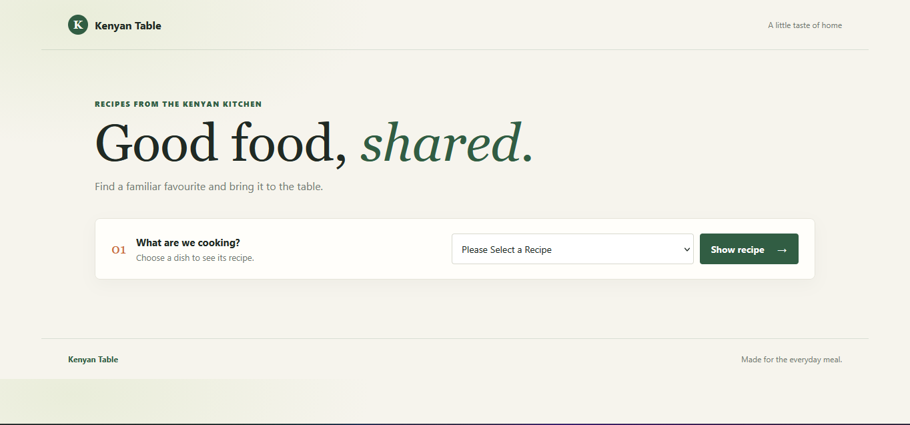
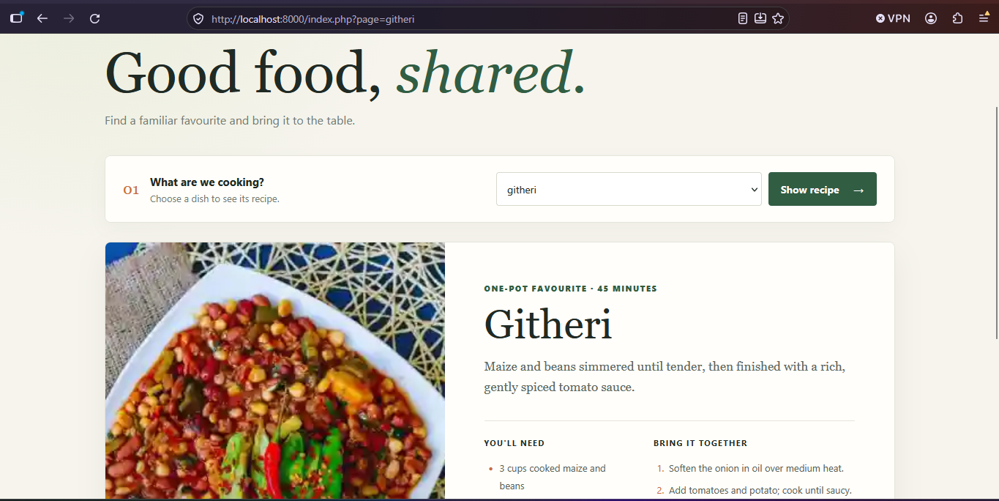

# Kenyan Table

A small PHP recipe site demonstrating query-string navigation and safer page routing. Choose a recipe from the form, or open one directly with a URL such as `index.php?page=githeri`.

## How routing works

The form submits with the `GET` method, so its selected recipe appears in the `page` query parameter. `index.php` compares that value against a fixed allowlist (`githeri`, `omena`, `sembe`, and `viazi`). Only a matching key is used to load a fragment from `pages/`; empty or unknown values render no recipe.

For example:

```text
index.php?page=omena
```

The page fragments contain the recipe content, while `styles.css` provides the responsive layout and styling.

## Security notes

- The allowlist prevents the request value from becoming an arbitrary file path. Keep routing based on known keys rather than concatenating raw query-string input into a filename.
- The `e()` helper applies `htmlspecialchars()` with quote escaping and UTF-8 when outputting values into HTML. Escaping protects HTML output; it is separate from validating which page may be loaded.
- A missing or unrecognized `page` value does not load a file.

## Run locally

From the project directory, start PHP's built-in development server:

```sh
php -S 127.0.0.1:8000
```

Then visit `http://127.0.0.1:8000/` in a browser. PHP must be installed and available on your command line.

## Screenshots

**Home page**



**Recipe results**


